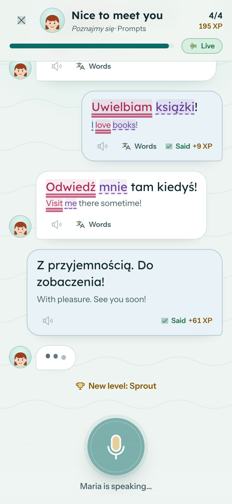
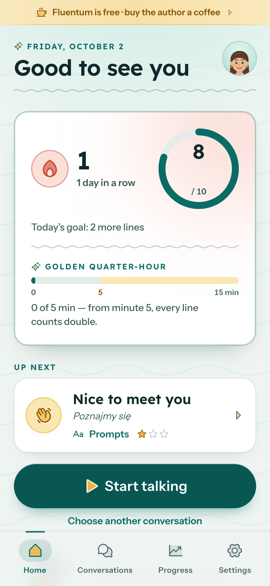
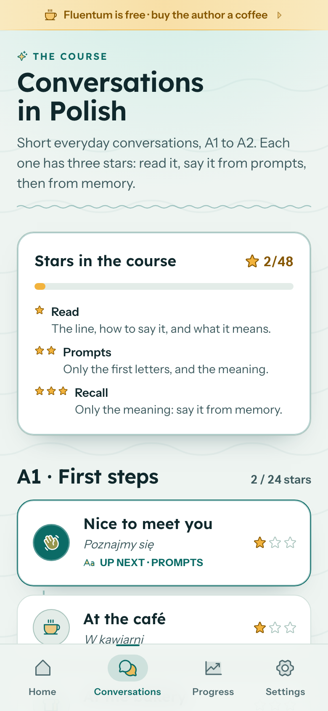

# Fluentum — speak a new language, one conversation a day

> *Fluent* + *momentum*; Latin *fluentum*, "a stream". Don't just read a language — **say it, out loud, every day.**

Fluentum is a free, local-first Progressive Web App for **speaking practice**: short everyday conversations in a
messenger-style chat. Your partner speaks first; you answer aloud; speech recognition and a forgiving matcher check every
line. Then you say the same conversation again from prompts, and finally from memory — three ways, three stars. Streaks, a
daily goal, levels and achievements keep you coming back. Polish speakers practise **English**; English speakers practise
**Polish**. No accounts, no servers, no ads, no tracking.

<p align="center">
  
  
  
</p>

## What it does

- **Conversations aloud:** 16 everyday scenes, A1 to A2 — meeting a neighbour, a café, a bakery, the weather, asking the way,
  the market, a taxi, a hotel, a restaurant, booking a table, the station, the airport, buying a jacket, the pharmacy, weekend
  plans, a birthday invitation. The partner's lines are spoken aloud with their meaning; yours come with the pronunciation
  spelt your way (stress in capitals) and what they mean.
- **Three ways, three stars:** *Read* the line → say it from *prompts* (first letters only) → *recall* it from its meaning.
  Words appear as you say them. A suggested path spaces the three ways out: a conversation returns for prompts one step after you first read it, and for
  recall one step after that.
- **Grammar you can see:** subjects, predicates, adjectives and objects are coloured — and underlined the way Polish schools
  mark a sentence — together with their counterparts in the translation. Tap a word to light up its pair.
- **Honest, forgiving checking:** a line counts when enough of its words were said and nothing was added — 90% on the first
  try, 80% on the second, 70% from the third on. Recognition slips (missing Polish letters, words split or run together,
  misheard words) are forgiven; fillers like "um" are ignored. Live listening checks each line as you speak.
- **Motivation:** XP, 20 levels (a plant that grows with your words), 49 achievements, streaks with freezes, a daily goal,
  the golden quarter-hour (5–15 minutes a day earn double points), friends' leaderboard by link, shareable cards.
- **Private by design:** everything stays in your browser (IndexedDB); audio is never stored. In some browsers the built-in
  speech recogniser sends audio to the browser vendor — the app says so first — and the optional **offline Whisper** engine
  (Settings → Speech) recognises speech entirely on the device, also in Firefox.
- **Feels like an app:** installable PWA, works offline, light and dark themes, three line sizes, keyboard (Space =
  microphone), calendar reminders, backups you can protect with a password and restore anywhere.

Changes: [CHANGELOG.md](CHANGELOG.md) · Product spec: [docs/FLUENTUM_SPEC.md](docs/FLUENTUM_SPEC.md) · Decisions:
[docs/DECISIONS.md](docs/DECISIONS.md) · Plan: [docs/plans/2026-10-02-fluentum.md](docs/plans/2026-10-02-fluentum.md)

## Development

Requirements: Node ≥ 22.22 (24 recommended), npm.

```bash
npm ci
npm run dev          # http://localhost:5173/fluentum/
npm run test         # unit + component tests (Vitest, watch mode)
npm run test:e2e     # end-to-end (Playwright; first run: npx playwright install chromium webkit firefox)
npm run lint         # oxlint
npm run build        # type-check + production build → dist/
npm run preview      # serve the production build at http://localhost:4173/fluentum/
```

Speech recognition needs a secure context: `localhost` works; on a phone use the deployed HTTPS URL. End-to-end tests replace
`SpeechRecognition` with a scriptable fake (`e2e/fakeSpeech.ts`) that "says" the line on screen, and speechSynthesis with a
silent voice.

## Publishing (free, on GitHub Pages)

The repository was created locally only — creating the public GitHub repository publishes the code, so that step is yours:

```bash
gh repo create AleksanderDudek/fluentum --public --source . --push
gh api -X POST repos/AleksanderDudek/fluentum/pages -f build_type=workflow   # Pages from GitHub Actions
```

Every push to `main` then runs `.github/workflows/deploy.yml` (lint, unit tests, build, deploy) and the app goes live at
**https://aleksanderdudek.github.io/fluentum/**. Pull requests run `.github/workflows/ci.yml` (lint, type-check, unit and e2e
tests). The GitHub Free plan serves Pages only from public repositories. For another repository name change `BASE` in
`vite.config.ts`.

## Project layout

```
src/domain/     pure rules: matcher, live tracker, dialogue (gloss, turns), mastery (ways, stars, course), gamification…
src/db/         Dexie (IndexedDB) schema and row types
src/services/   DB-coupled use cases (one transaction per user event)
src/content/    the course: dialogues.json (+ validation test)
src/screens/    route screens · src/components/ shared UI (ui/, brand/ portraits and Lori, icons/) · src/i18n/ PL + EN
public/         icons, screenshots, privacy policy · e2e/ Playwright tests
```

## Licence & content

© 2026 Aleksander Dudek — **all rights reserved** (see [LICENSE](LICENSE)). The code is public to read, but it may not be used,
copied, modified or redistributed without prior written agreement. The conversations, their pronunciation respellings, the
portraits, Lori and the mark were written or drawn for this project. Fonts: Lexend and Instrument Sans (SIL Open Font
License). Icons: Phosphor Icons (MIT). Fluentum grew out of the engine of Teleo, the author's app for prayers and affirmations.

Fluentum is free, with no ads and no tracking. If it helps you: [buy the author a coffee](https://buycoffee.to/uriel).
